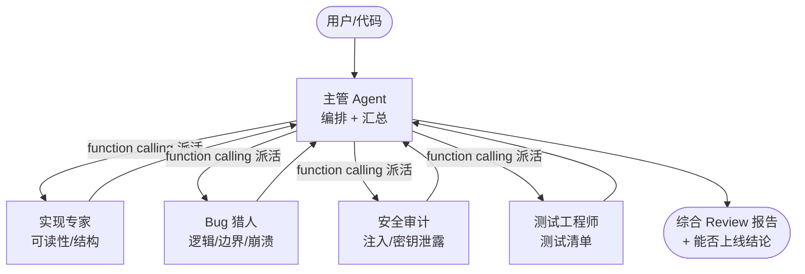

# Multi-Agent Code Review（多智能体代码审查）

一个**最小可运行**的多 Agent 协作项目：主管 Agent 把一段代码派给 4 个专家 Agent 分工审查，再汇总成一份带"能否上线"结论的 Review 报告。

> 这是我第二个 AI 作品。第一个是 RAG 问答系统（[ai-intel-officer](https://github.com/ym-coding-2026/ai-intel-officer)），这个项目的卖点从"检索增强问答"升级到了"多智能体自主协作"。

## 为什么用多 Agent，而不是一个 Agent？

把代码一次性丢给一个模型也能审，但容易"顾此失彼"——它可能盯着可读性，却漏掉安全漏洞。把任务拆给 4 个**只盯一个维度**的专家，再由主管统筹，质量更稳、也更能体现"分工协作"这个 Agent 工程的核心思想。

## 架构



每个"专家"本身也是一个 Agent（带专属 system prompt 的 DeepSeek 调用），主管则是用 **function calling** 把"派专家"当成工具来调——这就是多 Agent 协作的最小形态。

## 目录结构

```
agent-code-review/
├── agents/                 # 核心：多 Agent 包
│   ├── llm.py              #   共享层：DeepSeek 客户端 + Agent 循环 + 可观测性(token统计) + 容错(超时/重试)
│   ├── experts.py          #   4 个专家 Agent 的人设与调用
│   ├── manager.py          #   主管 Agent：编排 + 汇总
│   └── __init__.py
├── samples/
│   └── bad_example.py      # 内置示例（故意埋了 4 个已知问题）
├── eval/
│   └── known_issues.json   # 评测集：示例代码里的已知问题标注
├── main.py                 # 入口：跑一次完整 Review
├── eval.py                 # 评测：检出率 + 单/多 Agent 对比
├── requirements.txt
└── .gitignore
```

## 环境配置

1. Python 3.10+
2. 安装依赖：
   ```bash
   pip install -r requirements.txt
   ```
3. 设置 DeepSeek API Key（在 [platform.deepseek.com](https://platform.deepseek.com) 申请，免费）：
   ```bash
   # Windows（cmd）
   set DEEPSEEK_API_KEY=sk-你的key
   # PowerShell
   $env:DEEPSEEK_API_KEY="sk-你的key"
   ```
   > 该变量只对当前终端窗口有效；重开窗口需重设。也支持写入 `.env`（已被 .gitignore 忽略，不会上传）。

## 运行

```bash
# 用内置示例跑一次完整 Review
python main.py

# 审查你自己的代码文件
python main.py 你的文件.py
```

输出会依次打印：主管派发 4 位专家 → 最终综合 Review 报告（含能否上线结论）。运行结束后还会打印一段**可观测性统计**（见下）。

## 工程化特性：可观测性与容错

这个项目不只是"调一下 API"，还补了两条生产级系统该有的基本功：

### 1. 可观测性（Observability）

每次模型调用都会自动统计，并按 **Agent 角色** 拆分——你一眼能看出"主管 / 4 个专家 / 单 Agent 基线 / 评测裁判"各自花了多少 token、调了几次、花了多少钱。`main.py` / `eval.py` 末尾会自动打印：

```
==================================================
可观测性统计（本次运行，花费为 DeepSeek 公开价估算）
  总调用次数：5
  总输入 token：...
  总输出 token：...
  预估花费：¥...
  --- 按 Agent 角色拆分（按花费降序） ---
    [manager     ] 调用1次 | 输入... | 输出... | ¥...
    [security    ] 调用1次 | ...
    [bug_hunter  ] ...
    ...
```

这在面试时能直接讲："我给每个 Agent 加了调用追踪，能定位成本瓶颈和异常角色。"

### 2. API 容错（Fault Tolerance）

`agents/llm.py` 里的每次 API 调用都包了 **超时 + 失败重试**：

- **超时**：客户端 `timeout=30`，单次请求最多等 30 秒，避免模型/网络卡死挂起；
- **重试**：网络抖动或服务限流时，最多重试 3 次，**指数退避**（1s / 2s / 4s），每次失败都打日志，全失败才上抛。

这一条是"玩具 demo"和"工程化代码"的分水岭——真实环境下 API 不可能 100% 稳定，没有容错的系统一碰到抖动就整体崩。

## 评测

`eval.py` 用内建评测集检验团队能否把示例代码里**故意埋的 4 个已知问题**都揪出来，并和"单 Agent 基线"对比：

```bash
python eval.py
```

指标：**已知问题检出率 = 命中数 / 总数**。判断默认用 **LLM-as-judge**（让模型判断报告是否命中，比关键词更准），judge 失败则退回关键词匹配。

实测评测结果（2026-10-21 本地运行，DeepSeek `deepseek-chat`）：

| 方案 | 已知问题检出率 |
|------|--------------|
| 多 Agent 团队 | 4/4 = 100% |
| 单 Agent 基线 | 4/4 = 100% |

> **诚实结论**：在 4 个 deliberately injected 的缺陷（SQL 注入 / 硬编码密钥 / 除零崩溃 / 缺测试）上，两种配置都达到 100% 召回。这说明——**当样本小且缺陷明显时，单 Agent 也能全部发现，多 Agent 并不必然"多抓到几个问题"**。
>
> 多 Agent 在此项目中的真实价值不体现在"检出数量"，而在三点：
> 1. **维度归属**：每个问题都被明确指派到具体维度（实现质量 / 逻辑缺陷 / 安全风险 / 测试覆盖），便于开发者按角色整改；
> 2. **结构化报告**：主管汇总出带"能否上线"结论与整改清单的可执行报告，而非一坨流水文字；
> 3. **可扩展的分工范式**：新增审查维度（如性能、合规）只需新增一个专家 Agent，不必重写单 Agent 的长 prompt。
>
> 若想量化"多 Agent 优于单 Agent 的覆盖率差距"，需扩充评测集（加入更隐蔽、跨维度的缺陷），让单 Agent 因"顾此失彼"而漏检——这是项目后续可做的增强方向。

## 技术栈

- **DeepSeek (`deepseek-chat`)** + OpenAI Python SDK（兼容接口）
- **Function Calling**：主管自主决定派哪些专家、派几次
- **多 Agent 编排**：1 主管 + 4 专家，结果汇总
- **LLM-as-judge 评测**：用量化指标衡量系统质量
- **可观测性**：按 Agent 角色统计 token / 调用次数 / 预估花费
- **容错**：API 调用统一带超时（30s）+ 指数退避重试（最多 3 次）

## 项目亮点

- 真实 function calling：工具调用由**模型自主决策**，而非写死规则
- 多 Agent 分工 + 主管统筹，体现 Agent 工程核心思想
- 内建评测集与量化指标（对标生产级系统的验收方式）
- **可观测性**：每个 Agent 的 token 消耗与成本可追踪，便于定位瓶颈
- **容错设计**：超时 + 重试，避免一次 API 抖动拖垮整个 Review
- 可降级：无 key / 无网络时给出清晰提示而非崩溃

## 局限性（诚实说明）

- 示例与评测集较小，指标仅作演示，非统计显著结论
- 质量依赖底层 LLM，非确定性输出
- 是教学/作品级项目，非生产级代码审查工具（无静态分析、无 AST 解析）

## 与 RAG 项目的关系

两个**独立仓库、独立卖点**：

| | ai-intel-officer（RAG） | 本项目（Agent） |
|---|---|---|
| 卖点 | 检索增强问答：BM25+向量混合、rerank、引用、拒答、评测集 | 自主规划 + 工具调用 + 多智能体协作 |
| 领域 | 新闻情报问答 | 代码审查 |

RAG 解决"答得准、有出处"，Agent 解决"自己会干活、能分工"。两者合起来正好覆盖 AI 应用的两大范式。
