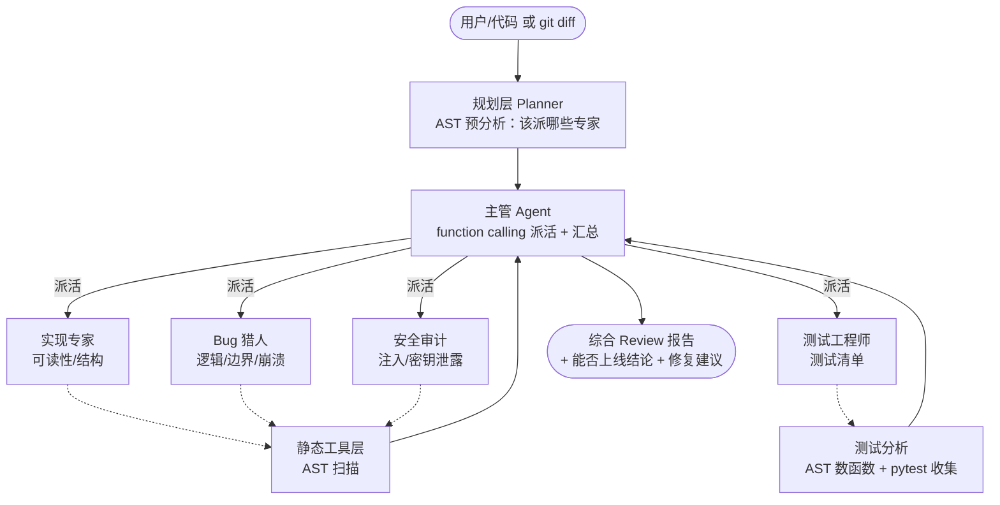

# Multi-Agent Code Review（多智能体代码审查）

一个**最小可运行**的多 Agent 协作项目：主管 Agent 把一段代码派给 4 个专家 Agent 分工审查，再汇总成一份带"能否上线"结论的 Review 报告。

> 这是我第二个 AI 作品。第一个是 RAG 问答系统（[ai-intel-officer](https://github.com/ym-coding-2026/ai-intel-officer)），这个项目的卖点从"检索增强问答"升级到了"多智能体自主协作"。

## 为什么用多 Agent，而不是一个 Agent？

把代码一次性丢给一个模型也能审，但容易"顾此失彼"——它可能盯着可读性，却漏掉安全漏洞。把任务拆给 4 个**只盯一个维度**的专家，再由主管统筹，质量更稳、也更能体现"分工协作"这个 Agent 工程的核心思想。

## 架构



三层结构（P1 之后）：

- **规划层（Planner）**：先用 AST 预分析代码特征（有没有函数、SQL、密钥、网络调用），决定**该派哪些专家**，而不是写死全派。
- **编排层（Manager）**：主管用 **function calling** 把"派专家"当工具，结合预分析建议自主拍板，再把专家意见汇总成报告。
- **工具层（Tools）**：专家不再"凭感觉"，而是先跑**确定性的静态分析工具**（纯 AST，零成本、零幻觉）拿到事实证据（哪行、什么规则、什么风险），再由 LLM 综合成报告。两层分离：工具负责"找得到"，模型负责"讲得清"。

## 目录结构

```
agent-code-review/
├── agents/                 # 核心：多 Agent 包
│   ├── llm.py              #   共享层：DeepSeek 客户端 + Agent 循环 + 可观测性(token统计) + 容错(超时/重试)
│   ├── experts.py          #   4 个专家 Agent 的人设与调用（P1：接入工具证据）
│   ├── manager.py          #   主管 Agent：function calling 编排 + 汇总（P1：动态规划）
│   ├── planner.py          #   P1 新增：AST 预分析，决定该派哪些专家
│   ├── tools/              #   P1 新增：真实工具层（确定性，纯标准库）
│   │   ├── static.py       #     AST 静态分析：安全/逻辑缺陷/测试覆盖
│   │   └── gitdiff.py      #     git diff 解析：把未提交改动变成可审文本
│   └── __init__.py
├── samples/
│   └── bad_example.py      # 内置示例（故意埋了 4 个已知问题）
├── eval/
│   └── known_issues.json   # 评测集：示例代码里的已知问题标注
├── main.py                 # 入口：跑一次完整 Review（支持文件 / --diff）
├── eval.py                 # 评测：检出率 + 单/多 Agent 对比
├── ci_review.py            # P2 新增：CI 入口（确定性静态审查，高危卡合并）
├── .github/workflows/      # P2 新增：GitHub Actions，让项目自己审自己的 PR
├── tests_tools.py          # P1 新增：确定性自测（不花 API，验证静态层命中已知问题）
├── requirements.txt
└── .gitignore
```

## 环境配置

1. Python 3.10+
2. 安装依赖：
   ```bash
   pip install -r requirements.txt
   ```
3. 设置 DeepSeek API Key（在 [platform.deepseek.com](https://platform.deepseek.com) 申请，免费）：
   ```bash
   # Windows（cmd）
   set DEEPSEEK_API_KEY=sk-你的key
   # PowerShell
   $env:DEEPSEEK_API_KEY="sk-你的key"
   ```
   > 该变量只对当前终端窗口有效；重开窗口需重设。也支持写入 `.env`（已被 .gitignore 忽略，不会上传）。

## 运行

```bash
# 用内置示例跑一次完整 Review
python main.py

# 审查你自己的代码文件
python main.py 你的文件.py

# 审查当前仓库未提交的 git 改动（贴近真实 PR 工作流）
python main.py --diff
```

输出会依次打印：规划层预分析 → 主管派发专家（数量由代码特征决定）→ 最终综合 Review 报告（含能否上线结论；`--diff` 模式下每条问题附带可复制的修复代码）。运行结束后还会打印一段**可观测性统计**（见下）。

> 零成本自测（不需要 API Key）：`python tests_tools.py` 会用确定性静态工具验证 4 个已知问题都能被"找得到"。

## 工程化特性：可观测性与容错

这个项目不只是"调一下 API"，还补了两条生产级系统该有的基本功：

### 1. 可观测性（Observability）

每次模型调用都会自动统计，并按 **Agent 角色** 拆分——你一眼能看出"主管 / 4 个专家 / 单 Agent 基线 / 评测裁判"各自花了多少 token、调了几次、花了多少钱。`main.py` / `eval.py` 末尾会自动打印：

```
==================================================
可观测性统计（本次运行，花费为 DeepSeek 公开价估算）
  总调用次数：5
  总输入 token：...
  总输出 token：...
  预估花费：¥...
  --- 按 Agent 角色拆分（按花费降序） ---
    [manager     ] 调用1次 | 输入... | 输出... | ¥...
    [security    ] 调用1次 | ...
    [bug_hunter  ] ...
    ...
```

这在面试时能直接讲："我给每个 Agent 加了调用追踪，能定位成本瓶颈和异常角色。"

### 2. API 容错（Fault Tolerance）

`agents/llm.py` 里的每次 API 调用都包了 **超时 + 失败重试**：

- **超时**：客户端 `timeout=30`，单次请求最多等 30 秒，避免模型/网络卡死挂起；
- **重试**：网络抖动或服务限流时，最多重试 3 次，**指数退避**（1s / 2s / 4s），每次失败都打日志，全失败才上抛。

这一条是"玩具 demo"和"工程化代码"的分水岭——真实环境下 API 不可能 100% 稳定，没有容错的系统一碰到抖动就整体崩。

## 工程化特性（进阶，P1）：真实工具 + 动态规划

P0 解决的是"稳不稳"（可观测、容错）。P1 解决的是"真不真"——不让项目停留在"只是把 LLM 包装一下"：

### 1. 工具增强型专家（Tool-augmented Experts）

安全、逻辑、测试三位专家不再只靠 LLM 凭感觉看代码，而是**先跑确定性静态分析工具**（`agents/tools/static.py`，纯标准库 `ast`+`re`，零额外依赖、零成本、零幻觉），把"哪一行、什么规则、什么风险"作为**事实证据**注入 prompt，再由 LLM 综合成报告。

- 安全扫描：硬编码密钥、SQL 字符串拼接注入、`eval/exec`、`os.system`、危险的反序列化等；
- 逻辑扫描：除零、裸 `except`、可变默认参数等；
- 测试分析：AST 数函数定义 + **真实跑 `pytest --co`** 统计能收集到几个测试（装了 pytest 才跑，没装则优雅降级）。

设计上刻意做了**分层**：静态层负责"找得到"（可复现、可作真值），LLM 层负责"讲得清"（翻译、排优先级、给修复建议）。`tests_tools.py` 就是基于这一层做的确定性自测。

### 2. 主管动态规划（Dynamic Planning）

原版主管的 prompt 写死"4 个专家都应派到"，所谓"自主规划"是假的。现在加了 **Planner 层**（`agents/planner.py`）：先用 AST 预分析代码特征（有函数 / 有 SQL / 有密钥 / 是否测试文件），给出"该派哪些专家"的建议并打日志，主管再结合建议用 function calling 自主拍板——**不必全派**。比如一段纯算法代码没有数据库操作，就不会派安全专家，省 token 也更聚焦。

### 3. git diff 审查模式

真实工作流里我们审的是 PR / 提交里的 diff，不是整文件重读。`main.py --diff` 用 `git diff` 拿到未提交改动，解析成"每个文件改了哪些行"，只把这些行喂给团队——既聚焦又省钱；`--diff` 模式下报告还会为每条问题附上**可复制的修复代码**。

## CI / 自动静态审查（dogfood，P2）

P1 让专家"有工具可用"，P2 让项目**真的能当工具用**——它会在每次开 PR 时**自己审自己的改动**，而不只是本地跑一遍 demo。

### 做了什么

- **`ci_review.py`**：CI 入口。自动拿到本次改动的 diff（本地未提交 / 已暂存 / PR 的 `origin/main...HEAD`），**只针对改动的 `.py` 文件、且只报"本次新增/修改行"上的问题**（行号精确，不会把文件里的历史遗留问题算到本次 PR 头上）。发现 high 级问题就以退出码 1 失败，**卡住合并**；中/低级只告警。
- **`.github/workflows/code-review.yml`**：在 `pull_request` / `push` 到 `main` 时自动运行上面的审查。**这一步只跑确定性静态分析，不需要 API Key、不花钱**，所以适合每次 PR 都跑。
- **扩展规则库**：在原有"安全/逻辑"基础上新增**风格/坏味道**检查——`open()` 没用 `with`、`requests` 没设 `timeout`、`assert` 当控制流、残留 `TODO/FIXME`。

### 为什么这一步对面试有用

很多"多 Agent"项目止步于"本地 demo"。加上 CI 后，这个项目就变成了一个**能接进真实开发流程的审查工具**：它自己审自己的 PR，开 PR 就会自动跑、高危直接红。这是"工程化闭环"最直观的证据。

```bash
# 本地模拟 CI：审当前改动（不需要 API Key）
python ci_review.py
python ci_review.py --json     # 额外输出 JSON（方便接其他系统）
```

> 说明：CI 只跑静态层（免费、确定性）。LLM 深度审查（`python main.py --diff`）是按需的人工动作，不在 CI 里跑。

## 评测

`eval.py` 用内建评测集检验团队能否把示例代码里**故意埋的 4 个已知问题**都揪出来，并和"单 Agent 基线"对比：

```bash
python eval.py
```

指标：**已知问题检出率 = 命中数 / 总数**。判断默认用 **LLM-as-judge**（让模型判断报告是否命中，比关键词更准），judge 失败则退回关键词匹配。

实测评测结果（2026-10-21 本地运行，DeepSeek `deepseek-chat`）：

| 方案 | 已知问题检出率 |
|------|--------------|
| 多 Agent 团队 | 4/4 = 100% |
| 单 Agent 基线 | 4/4 = 100% |

> **诚实结论**：在 4 个 deliberately injected 的缺陷（SQL 注入 / 硬编码密钥 / 除零崩溃 / 缺测试）上，两种配置都达到 100% 召回。这说明——**当样本小且缺陷明显时，单 Agent 也能全部发现，多 Agent 并不必然"多抓到几个问题"**。
>
> 多 Agent 在此项目中的真实价值不体现在"检出数量"，而在三点：
> 1. **维度归属**：每个问题都被明确指派到具体维度（实现质量 / 逻辑缺陷 / 安全风险 / 测试覆盖），便于开发者按角色整改；
> 2. **结构化报告**：主管汇总出带"能否上线"结论与整改清单的可执行报告，而非一坨流水文字；
> 3. **可扩展的分工范式**：新增审查维度（如性能、合规）只需新增一个专家 Agent，不必重写单 Agent 的长 prompt。
>
> 若想量化"多 Agent 优于单 Agent 的覆盖率差距"，需扩充评测集（加入更隐蔽、跨维度的缺陷），让单 Agent 因"顾此失彼"而漏检——这是项目后续可做的增强方向。

## 技术栈

- **DeepSeek (`deepseek-chat`)** + OpenAI Python SDK（兼容接口）
- **Function Calling**：主管自主决定派哪些专家、派几次
- **多 Agent 编排**：1 主管 + 4 专家，结果汇总
- **动态规划（P1）**：Planner 用 AST 预分析决定派遣方案，主管结合建议拍板
- **工具增强（P1）**：专家先跑 AST 静态分析拿事实证据，再综合报告
- **git diff 审查（P1）**：解析未提交改动，聚焦 + 省钱 + 给修复代码
- **CI 自动审查（P2）**：GitHub Actions 让项目自己审自己的 PR，高危直接卡合并（dogfood）
- **扩展规则库（P2）**：在 AST 安全/逻辑规则上新增风格坏味道检查（open/with、requests timeout、assert 控制流、TODO）
- **LLM-as-judge 评测**：用量化指标衡量系统质量
- **可观测性**：按 Agent 角色统计 token / 调用次数 / 预估花费
- **容错**：API 调用统一带超时（30s）+ 指数退避重试（最多 3 次）

## 项目亮点

- 真实 function calling：工具调用由**模型自主决策**，而非写死规则
- 多 Agent 分工 + 主管统筹，体现 Agent 工程核心思想
- **动态规划**：不是写死全派，而是按代码特征决定派哪些专家
- **工具增强**：专家基于确定性静态分析（AST）的事实证据做判断，不瞎编行号
- 内建评测集与量化指标（对标生产级系统的验收方式）
- 确定性自测 `tests_tools.py`：不花 API 即可验证静态层命中已知问题
- **可观测性**：每个 Agent 的 token 消耗与成本可追踪，便于定位瓶颈
- **容错设计**：超时 + 重试，避免一次 API 抖动拖垮整个 Review
- 可降级：无 key / 无网络 / 无 pytest 时均给出清晰提示而非崩溃

## 局限性（诚实说明）

- 示例与评测集较小，指标仅作演示，非统计显著结论
- 质量依赖底层 LLM，非确定性输出
- 静态分析规则是"够用的教学集"，非 bandit/semgrep 级别的完整规则库
- 是教学/作品级项目，非生产级代码审查工具（CI 只跑静态层；未自动把 LLM 审查贴到 PR 评论）

## 与 RAG 项目的关系

两个**独立仓库、独立卖点**：

| | ai-intel-officer（RAG） | 本项目（Agent） |
|---|---|---|
| 卖点 | 检索增强问答：BM25+向量混合、rerank、引用、拒答、评测集 | 自主规划 + 工具调用 + 多智能体协作 |
| 领域 | 新闻情报问答 | 代码审查 |

RAG 解决"答得准、有出处"，Agent 解决"自己会干活、能分工"。两者合起来正好覆盖 AI 应用的两大范式。
